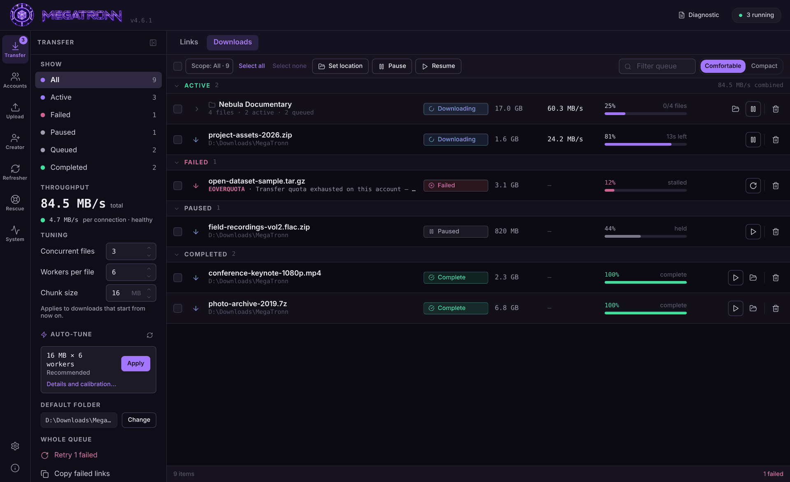
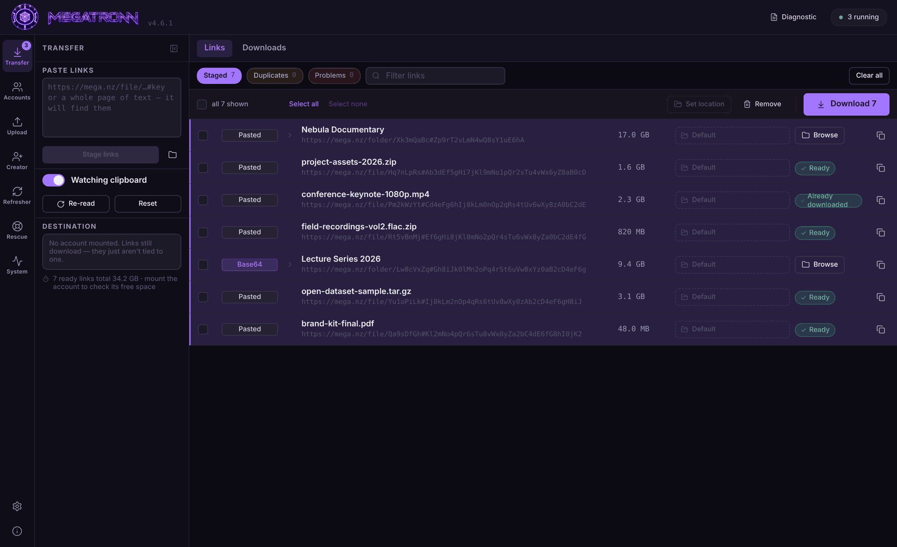
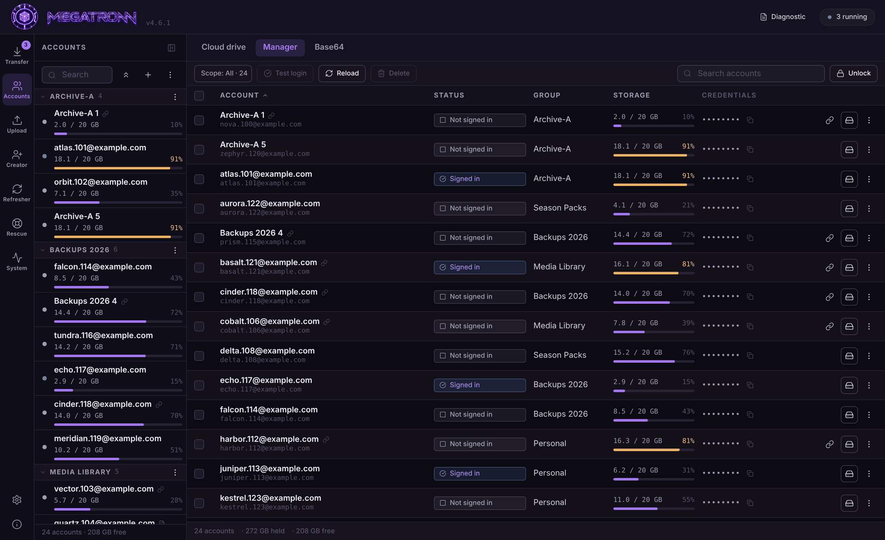
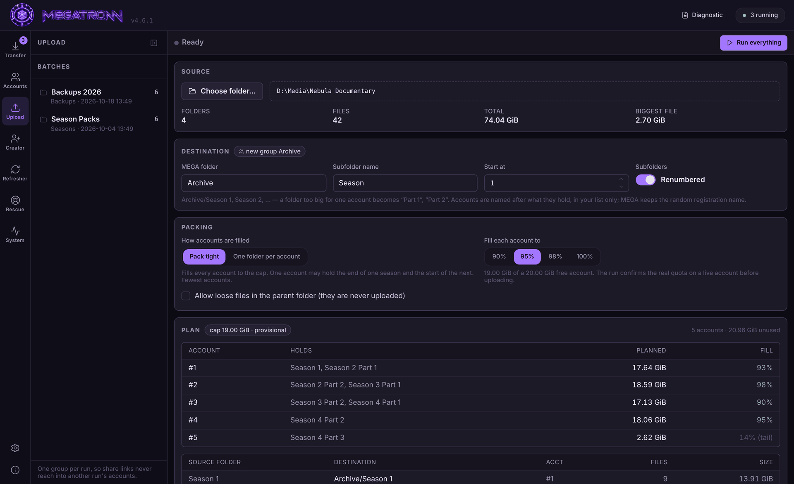
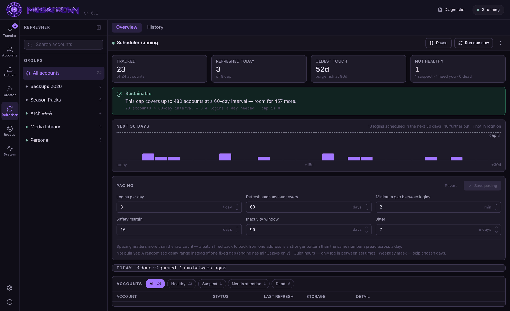
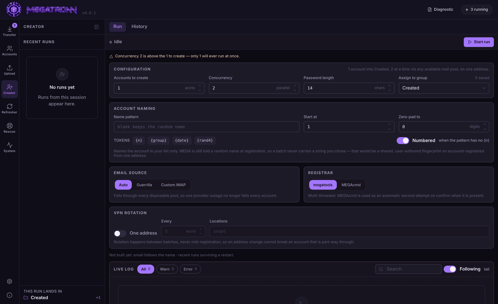
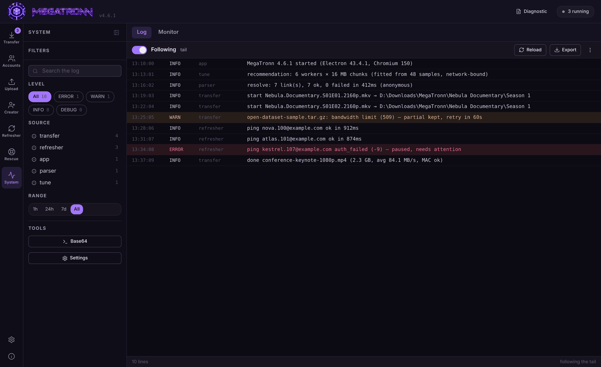

# MegaTronn

**A multi-account desktop client for MEGA: links in, files out, accounts kept alive.**

[**Download for Windows**](https://github.com/apennismightier/megatronn/releases/latest) · [Features](#features) · [Screenshots](#a-tour) · [Privacy](#privacy--safety) · [Changelog](https://github.com/apennismightier/megatronn/releases)

 

> [!NOTE]
> MegaTronn is independent third-party software. It is not affiliated with, endorsed by, or connected to Mega Limited. You are responsible for making sure your use complies with MEGA's Terms of Service.

---

## Why

The official MEGA apps assume one account and one link at a time. MegaTronn is built for the opposite: dozens or hundreds of accounts, link lists pasted from anywhere, and folders too large for a single free account. Everything lives in one window with seven sections down the left rail: **Transfer, Accounts, Upload, Creator, Refresher, Rescue, System**.

---

## A tour

> All screenshots use generated demo data. No real accounts or links appear.

### Links: paste anything, get a clean list

Paste a page of text, drop a `.dlc` / `.ccf` / `.rsdf` container, or just copy links while the clipboard watcher is on. Every MEGA link is pulled out, Base64 and double-Base64 included, and resolved to its real file name and size before you download. Duplicates and files you already have are flagged. Folder links expand in place so you can tick only the files you want, and every link can get its own download location.

### Downloads: one row per folder, real speed

A folder download is a single expandable row showing files done, active and queued. The queue panel on the left filters by status, shows combined and per-connection throughput, and lets you change concurrency, workers and chunk size on the fly.

### Accounts: the whole fleet at a glance

Group accounts, see storage used across all of them, attach notes and each account's root link, and copy the root link as plain text, Base64 or double Base64. Credentials stay masked until you unlock them.

### Upload: pack a folder tree into accounts automatically

Point it at a parent folder of subfolders (one per season, say). MegaTronn plans how to fill 20 GB free accounts, splits any folder too big for one account into parts, creates the accounts it needs, uploads everything and gives you the share links. Each run gets its own account group, so links from one run never reach into another.

### Refresher: keep stored files from expiring

MEGA deletes the *files* in an account after about three months of inactivity. The Refresher logs in on a paced, jittered schedule to keep them alive, and tells you up front whether your daily cap can cover your fleet.

<b>More screenshots</b>: Creator and the System log

 

**Creator**: register new accounts in batches, named and grouped the way you want.

**System · Log**: live tail with level and source filters, one-click export.

---

## Features

### ⬇️ Transfer
- **Multi-connection chunked downloads** with resume from disk: progress is kept in a `.part` file plus a sidecar, so a transfer picks up at the exact byte it reached after a restart, a dropped connection or an IP change
- **Auto-tune** (Settings · Performance) works out the best workers × chunk size for *your* connection by fitting a model to measurements every download already takes. Nothing is hard-coded for one machine
- **Per-link download locations**, bulk *Set location*, and re-pointing queued files before they start
- **Folder structure kept, share name dropped**: links with the same subfolder (e.g. `Season 1`) merge into one folder on disk. Same name and size gets skipped; a different size gets saved as `name (2).ext`. Nothing is ever overwritten
- **Quota-wall handling**: hit MEGA's transfer limit and the download pauses with its partial file intact, then retries
- 429 back-off, MAC integrity checking, and duplicate detection so you never spend quota twice on the same file
- Container import (`.dlc`, `.ccf`, `.rsdf`, `.txt`), file associations and drag-and-drop onto the exe
- Staged links survive a restart

### 👥 Accounts
- Unlimited accounts in named groups, with search, bulk move and bulk remove
- **Notes** and a **root link** on every account, with bulk *Attach root links…* for accounts you already have
- **Cloud drive**: mega.nz embedded in the app and signed in automatically, one isolated session per account
- **Import / Export wizard**: CSV, TXT, TSV, YAML, JSON, four-line blocks and `email:password`. It shows exactly how it will read your file, lets you remap the columns, and needs your approval before it writes anything
- **Base64 tool**: layered 1×/2×/3× conversion that tells you which round failed, plus a per-line mode
- Passwords encrypted at rest with the OS keychain (`safeStorage`); sessions closed with MEGA's real logout so live sessions don't pile up

### ⬆️ Upload
- Plans a folder tree into 20 GB accounts: **Pack tight** (fewest accounts) or **One folder per account**, filled to a 90–100% cap that's checked against real quota before uploading
- Creates accounts as needed and names them after what they hold (`Season 1–2`, `Season 4 Part 1`) in your list. MEGA still gets a random registration name
- Checks what's already on MEGA first, then lets you choose Merge (keep what's there) or Overwrite
- Exports credentials and collects each account's share link as its root link

### ➕ Creator
- Batch account registration with a free-form naming pattern (`{n}`, `{group}`, `{date}`, `{rand4}`) and optional numbering
- **Assign to group** is a searchable picker of your existing groups, and it matches names regardless of case
- Email-source fallback across disposable providers or your own IMAP mailbox; `megatools` registrar with MEGAcmd as a second attempt
- Optional VPN rotation between batches

### ↻ Refresher and ⚕ Rescue
- **Capacity planning**: logins a day needed versus your cap, with a warning and the minimum fix if a full sweep would outrun the inactivity window
- ±7-day jitter per account, a minimum gap between logins, and a safety margin
- Errors classified by MEGA's numeric code, never by string matching. Throttling never counts against an account, and "dead" takes two consecutive confirmations
- Wrong password or 2FA accounts are paused and flagged instead of retried forever
- **Rescue** is a separate queue for reactivating dormant or suspended accounts

### 🛠 System
- Live log viewer with level, source and time filters, and export
- Performance monitor (memory and transfer stats)
- **Proxy support** (HTTP / SOCKS4 / SOCKS5) with sticky or per-request rotation and a *Test first proxy* button that reports the IP MEGA would see
- In-app updates, a changelog viewer and a "you just updated" popup
- System tray, single-instance window, and a taskbar pin that survives upgrades

---

## Install

1. Download **`MegaTronn Setup <version>.exe`** from the [latest release](https://github.com/apennismightier/megatronn/releases/latest).
2. Run it. It installs per-user (no admin rights) to `%LocalAppData%\Programs\MegaTronn`.
3. Pin it to the taskbar. The pin survives future updates, and the app tells you when a new release is out.

> [!WARNING]
> The installer isn't code-signed, so Windows SmartScreen warns on first run. Click **More info → Run anyway**.

**Requirements:** Windows 10 or 11, x64.

---

## Privacy & safety

- **No telemetry**: no analytics, no crash reporting, no usage data of any kind
- **Local-only state**: accounts, settings, the queue, refresher state and logs live in `%AppData%\megatronn\` and are never sent anywhere
- **Network traffic goes only to MEGA**, plus one anonymous check per launch to `api.github.com` for updates. Creator runs also contact the email provider you pick
- **Passwords are encrypted at rest** with the OS keychain. Copy the store to another machine and it's unreadable
- Each embedded Cloud drive session is sandboxed in its own partition, so accounts can't see each other's cookies or storage

> [!CAUTION]
> **Account exports contain plain-text passwords.** That's what makes them portable backups. The app asks you to confirm before writing one. Store it somewhere safe, or untick the Password column to export without credentials.

---

## Under the hood

| Layer | Stack |
|---|---|
| Runtime | Electron 43 (Chromium 150, Node 24) |
| UI | React 18 · TypeScript 5 · Tailwind CSS · lucide icons |
| Build | electron-vite 5 · Vite 7 · electron-builder 26 (NSIS) |
| State | Zustand · electron-store |
| MEGA | [`megajs`](https://github.com/qgustavor/mega) with a CBC-based MAC replacement (~60× faster, bit-exact) |
| Tests | 34 suites · 1,924 assertions · plain Node type-stripping, no framework |

All the scheduling, planning, parsing and tuning logic is in **pure modules with no Electron imports**: the refresher scheduler, the upload planner, the auto-tune model, the import parser and the download-location resolver. That's why they can be tested with plain Node and why bugs in them get caught before a release rather than after.

---

## Roadmap

- [ ] macOS build (a CI smoke test already runs on Apple Silicon)
- [ ] Bandwidth limiter
- [ ] Scheduled / time-windowed transfers
- [ ] Automatic VPN rotation when the transfer quota is hit
- [ ] Webhook notifications on completion

Have an idea? [Open an issue](https://github.com/apennismightier/megatronn/issues).

---

## Reporting a bug

Please attach a diagnostic bundle (the **Diagnostic** button at the top right). It packs the log, queue state, settings and system info into one text file. For transfer or login problems it matters most: every attempt records MEGA's raw numeric error code, and that's usually the difference between a diagnosis and a guess.

---

© DeceptiCloud · mega.nz, MEGA and the MEGA logo are trademarks of Mega Limited.

